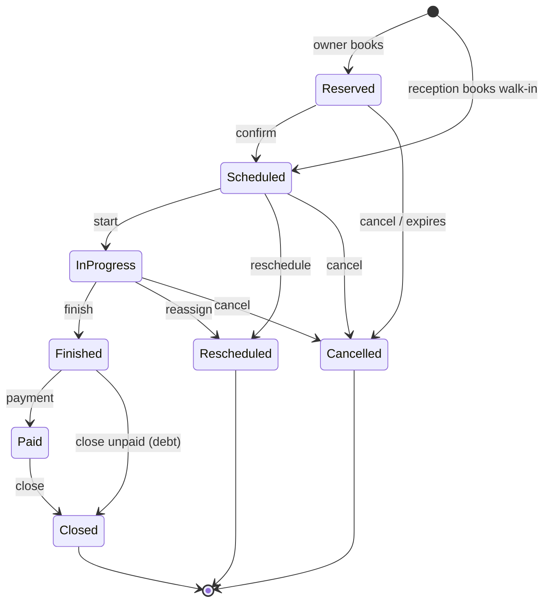

# Vet Clinic

## System Overview

Vet Clinic is a web application for booking and running appointments at a veterinary clinic. Owners book services for their pets online based on real-time veterinarian availability, and reception handles walk-ins, payments and the day's appointments from one screen.

Roles:

- **Owner:** signs in, picks a pet and a service, books an available slot and follows their appointments.
- **Receptionist:** registers owners, pets and veterinarians, books walk-in appointments, manages ongoing appointments and records payments.
- **Veterinarian:** starts and finishes the appointments assigned to them.

Main entities:

- **Owners** are clients identified by name and phone. An owner has one or more pets.
- **Pets** are dogs or cats, each with a fixed list of five breeds:
  - Dogs: Labrador Retriever, German Shepherd, Golden Retriever, Bulldog, Mixed breed.
  - Cats: Siamese, Persian, Maine Coon, Bengal, Mixed breed.
- **Veterinarians** have a name, a specialization, a cost per service and a weekly working schedule. Availability is calculated from that schedule and existing appointments.
- **Services** are fixed: general consultation, grooming, vaccination and hospitalization. Each has an estimated duration and a base price.
- **Appointments** book one service for one pet with one veterinarian at a given time. Each records who booked it (owner or reception), its status, total and observations.
- **Payments** settle one appointment in full with a single payment.
- **Service history** is the list of a pet's past and upcoming appointments.

## Main User Flows

- **Register:** reception registers an owner and their pets, and registers veterinarians with their weekly schedule.
- **Book online:** a signed-in owner picks a pet and a service, optionally a veterinarian and a date, and sees free slots in real time. Choosing a slot reserves it; confirming schedules the appointment. An unconfirmed reservation expires and frees the slot.
- **Book a walk-in:** reception books for any pet the same way, and the appointment is scheduled immediately.
- **Visit:** the veterinarian or reception starts the appointment and later marks it finished, adding observations as needed.
- **Pay and close:** reception records the payment for the total and closes the appointment. If the owner does not pay, reception closes it unpaid and it is listed as a debt.
- **Reschedule or reassign:** reception moves an appointment to another time or veterinarian. The original becomes rescheduled and a new linked appointment is scheduled.
- **Cancel:** reception cancels an active appointment with a reason; an owner can cancel their own reserved or scheduled appointment with a reason.
- **Follow up:** owners see all their appointments across pets and days with service, veterinarian, time and estimated duration. Reception sees all ongoing appointments with actions to cancel or take payment, and opens a pet's service history.

## Business Rules

### Owners, pets and veterinarians

- Owner name and phone are required; phone is unique.
- A pet belongs to one owner and has a name, species and breed; the breed must belong to the species.
- Owners see only their own pets and appointments.
- A veterinarian's schedule blocks on the same weekday do not overlap, and each block starts before it ends.
- Prices and veterinarian costs are zero or more.

### Booking and availability

- One appointment covers exactly one service for one pet with one veterinarian.
- A slot is available when the service's estimated duration fits inside the veterinarian's schedule and does not overlap their reserved, scheduled or in-progress appointments.
- Appointments are booked in the future.
- Two bookings cannot take the same slot; the second one is rejected and the user sees fresh availability.
- The appointment total is the service base price plus the veterinarian's cost per service, fixed at booking.

### Appointment lifecycle

| From        | To          | Who                          | Condition                                  |
|-------------|-------------|------------------------------|--------------------------------------------|
| Reserved    | Scheduled   | Owner, reception             | Confirmed before the reservation expires   |
| Reserved    | Cancelled   | Owner, reception, system     | Reason given, or reservation expired       |
| Scheduled   | In progress | Veterinarian, reception      | —                                          |
| Scheduled   | Rescheduled | Reception                    | New slot is available                      |
| Scheduled   | Cancelled   | Owner, reception             | Reason given                               |
| In progress | Finished    | Veterinarian, reception      | —                                          |
| In progress | Rescheduled | Reception                    | New veterinarian or slot is available      |
| In progress | Cancelled   | Reception                    | Reason given                               |
| Finished    | Paid        | Reception                    | One payment equal to the total             |
| Finished    | Closed      | Reception                    | Unpaid; recorded as a debt                 |
| Paid        | Closed      | Reception                    | —                                          |

- Rescheduled, Cancelled and Closed are final; no further changes are allowed.
- Any other transition is rejected.
- Observations can be edited until the appointment is closed or cancelled.

## Technology Constraints

- Backend: Java 21, Spring Boot 4.1 (Web MVC, Data JPA, Validation, Security), built with the Maven Wrapper.
- Authentication: stateless JWT issued by the backend on sign-in; roles carried in the token and enforced on every protected endpoint.
- The frontend never exposes the JWT to browser scripts: Next.js keeps it in an HttpOnly, Secure, SameSite cookie and forwards it to the backend on each request; sign-out clears the cookie.
- Database: H2 in-memory; schema generated from the entities; data resets on restart.
- API documented with OpenAPI.
- Frontend: Next.js 16 (App Router), React 19, TypeScript, Tailwind CSS, managed with npm.
- Testing and quality: JUnit 5 with MockMvc on the backend; ESLint on the frontend.
- Money uses exact decimal types, never floating point.
- No Docker.
- Seeded demo data: one receptionist account, two veterinarians with weekly schedules, and the four services.

## Acceptance Criteria

- Reception can register an owner with pets and a veterinarian with a weekly schedule; invalid data (missing name or phone, breed not matching species, overlapping schedule blocks) is rejected with a clear message.
- The breed picker only offers breeds of the selected species.
- An owner sees only free slots for the chosen service, veterinarian and date, and the slots refresh when any of them change.
- An owner can reserve and confirm a slot; an unconfirmed reservation expires and the slot becomes free again.
- Two bookings for the same veterinarian and overlapping time cannot both succeed.
- A walk-in booked by reception is scheduled immediately and records reception as the booker.
- Each status transition in the table works for the listed roles, and every other transition is rejected.
- Cancelling without a reason is rejected.
- Rescheduling or reassigning marks the original as rescheduled and creates a linked scheduled appointment.
- A payment is accepted only for a finished appointment and only for its exact total; a second payment is rejected.
- A finished appointment closed without payment appears as a debt.
- An owner sees all their appointments across pets and days with estimated duration and cannot see other owners' data.
- Reception sees all ongoing appointments with cancel and payment actions, and can open a pet's service history.
- Each status shows a consistent badge, and only allowed actions are offered.
- The backend builds and its tests pass; the frontend builds and lints cleanly.

## Out of Scope

- Medical history, diagnoses, medications, prescriptions and attachments.
- Species other than dogs and cats, and breeds beyond the five per species.
- More than one service per appointment, and services beyond the four listed.
- Partial payments, refunds, invoices and online payment processing.
- Notifications, reminders and messaging.
- Reporting and analytics.
- Multiple clinics or branches.
- Persistent storage across restarts.
