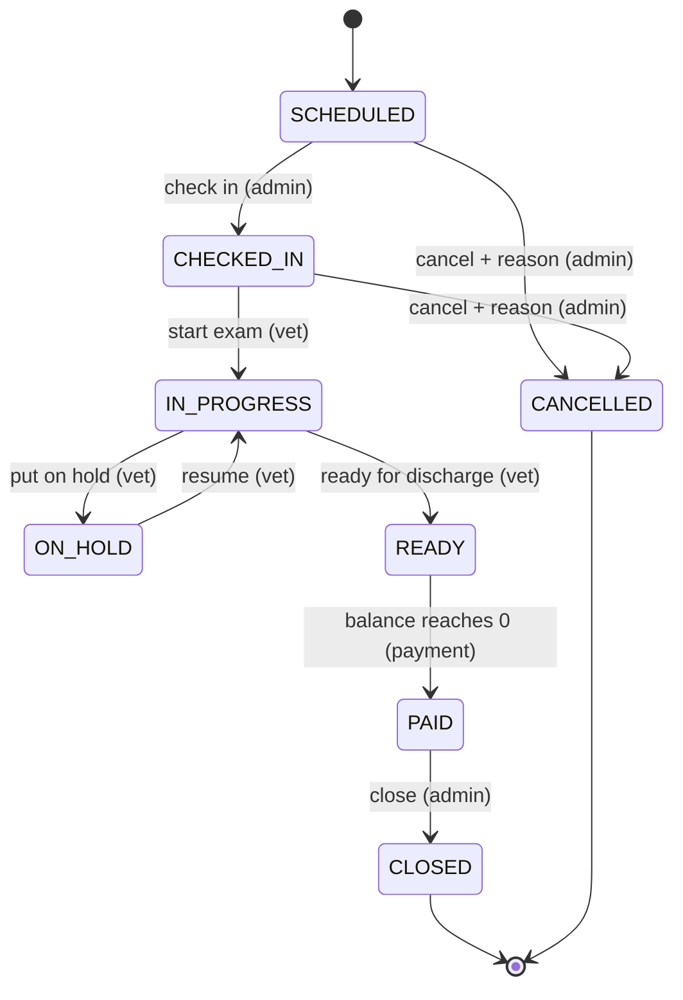

# Vet Clinic Service

## 1. Description

Build a **Vet Clinic Service**: a web application that replaces paper cards and spreadsheets in a small veterinary clinic. Reception staff register pet owners and their pets, book appointments, and take payments. Veterinarians work through their appointments, record diagnoses, add services and medications, and write prescriptions. Every pet keeps a complete medical history, and every appointment follows a transparent, auditable lifecycle from booking to closure.

### Roles

| Role                      | Who                    | Can do                                                                                          |
|---------------------------|------------------------|-------------------------------------------------------------------------------------------------|
| **Administrator**         | Reception staff        | Manage owners, pets, the service and medication catalogs; book, check in, cancel, take payment, close appointments; roll back an appointment status; view the audit log |
| **Veterinarian**          | Clinic doctors         | See all appointments (filterable to own); start, pause, resume and finish examinations of appointments assigned to them; record complaint details, anamnesis, diagnosis and notes; add services, medications and prescriptions to their appointments |

- Users sign in with **predefined accounts** created by seed data (at least one administrator and two veterinarians).
- Pet owners are **clients, not users**: they do not sign in.

### Domain Model

- **Owner**: full name, phone, email (optional), address (optional). One owner has many pets.
- **Pet**: name, species (dog / cat / other), breed, sex, date of birth, weight, coloring, chip number (optional), owner.
- **Employee**: full name, role (administrator / veterinarian), specialization for veterinarians (therapist, surgeon, dentist…), sign-in account.
- **Service**: code, name, duration in minutes, price, active flag (e.g. examination, vaccination, ultrasound, surgery).
- **Medication**: SKU, name, dosage form, sale price, active flag.
- **Appointment**: the central record. Includes the scheduled date and time, pet, assigned veterinarian, the administrator who created it, and the owner's complaint. It also holds anamnesis, diagnosis, examination notes, line items, total, amount paid, status and cancellation reason.
- **Line item**: belongs to an appointment. Refers to either a service or a medication, with quantity, unit price (copied from the catalog at the time it is added), line total, and the veterinarian who performed or dispensed it.
- **Prescription**: belongs to an appointment. Holds the medication name, dosage, frequency, course duration and instructions.
- **Payment**: belongs to an appointment. Holds amount, date/time, method (cash / card) and who recorded it.
- **Audit entry**: who, when, which appointment, what changed (status from → to, or amount), and a reason when applicable.

---

## 2. Main User Flows

- **UF-1 — Register a client:** the administrator creates an owner, then adds one or more pets to that owner.
- **UF-2 — Book an appointment:** the administrator picks a pet, a veterinarian, a date and time, and records the owner's complaint. The appointment is created in status `SCHEDULED`.
- **UF-3 — Visit:** the pet arrives (administrator: *Check in*). The assigned veterinarian then:
   - starts the examination
   - records anamnesis, diagnosis and notes
   - adds services, medications and prescriptions
   - marks the appointment *Ready for discharge*
- **UF-4 — Wait for results:** during an examination the veterinarian can put the appointment *On hold* (e.g. waiting for lab results or the owner's decision) and later resume it.
- **UF-5 — Payment and closing:** the administrator records one or more payments. When the balance reaches zero the appointment becomes `PAID`, and the administrator closes it.
- **UF-6 — Cancel:** the administrator cancels an appointment that has not started yet, with a reason.
- **UF-7 — Correct a mistake:** the administrator rolls an appointment back to an earlier status with a mandatory reason; this is recorded in the audit log.
- **UF-8 — Find information:** staff search by owner name, phone, pet name, or chip number. They open an owner card (pets and appointment timeline) or a pet card (full medical history).

### Pages

| Page                | Description                                                                                       |
|---------------------|---------------------------------------------------------------------------------------------------|
| Sign in             | Username/password form; shown for any page when not signed in                                     |
| Appointments        | Main page: table of appointments with filters by date range, status, veterinarian, and pet; "My appointments" quick filter for vets |
| Appointment detail  | Header with pet, owner, vet, status badge and allowed action buttons. Sections for clinical data, line items with running total, prescriptions, payments with balance, and status history |
| New appointment     | Form: pet (searchable), veterinarian, date/time, complaint                                         |
| Owners              | Searchable owner list; create owner                                                               |
| Owner card          | Owner details, pets, appointment timeline; edit, soft-delete, add pet                              |
| Pet card            | Pet profile and full medical history (appointments with diagnoses, prescriptions); edit, soft-delete |
| Catalog             | Services and medications lists; create, edit, activate/deactivate (administrator only)            |
| Audit log           | Filterable list of audit entries (administrator only)                                             |
| Global search       | Single search box: owner name, phone, pet name, chip number                                       |

### UI Behavior

- **UI-1:** Status shown as colored badges, with one consistent color per status everywhere.
- **UI-2:** Only the actions allowed for the current status **and** the current user's role are shown.
- **UI-3:** Destructive or irreversible actions ask for confirmation: cancel, rollback, delete owner/pet, close.
- **UI-4:** Cancel and rollback dialogs require a reason before the confirm button is enabled.
- **UI-5:** Forms validate the same constraints as the backend and show backend errors next to the relevant field.
- **UI-6:** Lists show readable empty states and paginate.
- **UI-7:** Layout works on desktop and tablet widths without horizontal scrolling.

---

## 3. Business Rules

### Owners and pets

- **BR-1:** Owner full name and phone are required. Email is optional but must be valid when provided.
- **BR-2:** Owner phone must be unique among active owners.
- **BR-3:** A pet must belong to exactly one existing owner.
- **BR-4:** Pet name, species and sex are required. Date of birth cannot be in the future. Weight, when provided, must be greater than zero.
- **BR-5:** Chip number, when provided, must be unique across all pets.
- **BR-6:** Owners and pets are **soft-deleted**: they disappear from lists and search, but their historical appointments remain intact and readable.
- **BR-7:** An owner cannot be deleted while they have a pet with an appointment that is not `CLOSED` or `CANCELLED`.

### Catalog

- **BR-8:** Service code and medication SKU are unique. Prices are greater than or equal to zero.
- **BR-9:** Catalog items are never deleted; they are deactivated. Inactive items cannot be added to new line items but remain visible on past appointments.
- **BR-10:** Changing a catalog price does not change line items already added to appointments.

### Appointments

- **BR-11:** An appointment requires a pet, an assigned veterinarian, and a scheduled date and time that is not in the past when booked.
- **BR-12:** A veterinarian cannot have two non-cancelled appointments starting at the same date and time.
- **BR-13:** Clinical fields (anamnesis, diagnosis, notes), line items and prescriptions can be changed only while the appointment is `IN_PROGRESS` or `ON_HOLD`.
- **BR-14:** Only the assigned veterinarian can perform clinical actions on an appointment.
- **BR-15:** The appointment total is the sum of its line item totals; a line total is quantity × unit price. Quantity must be a positive integer.
- **BR-16:** Balance = total − sum of payments. A payment amount must be greater than zero and cannot exceed the current balance.
- **BR-17:** Payments can be recorded only when the appointment is `READY`.

### Status lifecycle

- **BR-18:** Status transitions follow only the state machine below; any other transition is rejected with a clear error.
- **BR-19:** Transition rules are defined in one place (a single state-machine component with an explicit guard per transition), not scattered across the code.
- **BR-20:** `CANCELLED` is allowed only from `SCHEDULED` or `CHECKED_IN` and requires a non-empty reason.
- **BR-21:** `PAID` is reached automatically when a payment brings the balance to exactly zero; it can never be reached with a non-zero balance.
- **BR-22:** `CLOSED` and `CANCELLED` are terminal: no further changes of any kind.
- **BR-23:** Only an administrator can roll an appointment back one step along the main chain (e.g. `READY` → `IN_PROGRESS`). A rollback requires a reason. A rollback from `PAID` is not allowed.

### Audit

- **BR-24:** Every status change (forward, cancel, hold/resume, rollback) and every payment creates an audit entry with user, timestamp, old value, new value and reason (if any).
- **BR-25:** Audit entries are append-only: they cannot be edited or deleted.

### Appointment State Machine

| From          | To            | Who            | Guard                                     |
|---------------|---------------|----------------|-------------------------------------------|
| SCHEDULED     | CHECKED_IN    | Administrator  | —                                         |
| SCHEDULED     | CANCELLED     | Administrator  | reason required                           |
| CHECKED_IN    | IN_PROGRESS   | Assigned vet   | —                                         |
| CHECKED_IN    | CANCELLED     | Administrator  | reason required                           |
| IN_PROGRESS   | ON_HOLD       | Assigned vet   | —                                         |
| ON_HOLD       | IN_PROGRESS   | Assigned vet   | —                                         |
| IN_PROGRESS   | READY         | Assigned vet   | diagnosis is filled in                    |
| READY         | PAID          | System         | balance = 0 after a payment (incl. total 0) |
| PAID          | CLOSED        | Administrator  | —                                         |
| *rollback*    | previous step | Administrator  | reason required; not from PAID/CLOSED/CANCELLED |

---

## 4. Technology Constraints

| Layer     | Technology                                                                 |
|-----------|----------------------------------------------------------------------------|
| Backend   | Java 21, Spring Boot 4.1, Spring Web MVC, Spring Data JPA, Spring Validation, Spring Security |
| Database  | PostgreSQL 17 (local via `compose.yaml`), schema managed by Flyway         |
| API docs  | springdoc-openapi (Swagger UI at `/swagger-ui.html`)                       |
| Frontend  | Next.js 16 (App Router), React 19, TypeScript, Tailwind CSS                |
| Build     | Maven Wrapper (`backend/mvnw`), npm (`frontend`)                           |
| Testing   | JUnit 5, Spring MockMvc, Testcontainers (PostgreSQL); ESLint for frontend  |

- **TC-1:** PostgreSQL is the system of record. Schema changes are made only through versioned Flyway migrations.
- **TC-2:** Indexes exist on owner phone, pet chip number and pet name (search fields).
- **TC-3:** Soft-deleted records stay in the database with a deletion marker.
- **TC-4:** Money is stored as exact decimals (no floating point).
- **TC-5:** Local development uses the PostgreSQL service defined in `compose.yaml`. Automated tests use an isolated PostgreSQL Testcontainer and never the compose database.
- **TC-6:** Other data stores (e.g. Redis, MongoDB) only if a requirement cannot reasonably be met with PostgreSQL; the reason is recorded in the plan.

---

## 5. Acceptance Criteria

- **AC-1:** `./mvnw spring-boot:run` starts the backend; it starts or connects to the PostgreSQL service in `compose.yaml` and applies all migrations.
- **AC-2:** `npm run dev` starts the frontend, which talks to the backend.
- **AC-3:** Unauthenticated users can access only the sign-in page and health endpoint; every other page and API call requires sign-in.
- **AC-4:** Seeded administrator and veterinarian accounts can sign in and sign out.
- **AC-5:** An administrator can create, edit, list, search and soft-delete owners; duplicate active phone numbers are rejected.
- **AC-6:** An administrator can add pets to an owner and edit them; duplicate chip numbers and future birth dates are rejected.
- **AC-7:** A soft-deleted owner or pet no longer appears in lists or search, but their past appointments remain viewable.
- **AC-8:** An owner with an open appointment cannot be deleted.
- **AC-9:** An administrator can manage services and medications, deactivate them, and inactive items cannot be added to appointments.
- **AC-10:** An administrator can book an appointment; past dates and double-booking a vet at the same time are rejected.
- **AC-11:** The appointments page lists appointments and filters them by date range, status, veterinarian and pet.
- **AC-12:** Every forward transition in the state machine works for the right role, and every transition not in the state machine is rejected by the backend with a clear error.
- **AC-13:** Cancelling requires a reason and is possible only from `SCHEDULED` or `CHECKED_IN`.
- **AC-14:** A veterinarian can put their in-progress appointment on hold and resume it.
- **AC-15:** A veterinarian can record anamnesis, diagnosis, notes, line items and prescriptions only on their own appointment and only while it is `IN_PROGRESS` or `ON_HOLD`.
- **AC-16:** The appointment total always equals the sum of line items. Later catalog price changes do not affect existing line items.
- **AC-17:** Payments can be recorded only on `READY` appointments, cannot exceed the balance, and the appointment becomes `PAID` exactly when the balance reaches zero.
- **AC-18:** An administrator can close a `PAID` appointment; closed and cancelled appointments cannot be changed in any way.
- **AC-19:** An administrator can roll an appointment back one step with a reason; veterinarians cannot.
- **AC-20:** Every status change, rollback and payment appears in the audit log with user, time, old/new values and reason.
- **AC-21:** The pet card shows the pet's full medical history in chronological order.
- **AC-22:** Global search finds owners and pets by owner name, phone, pet name and chip number.
- **AC-23:** The UI shows only the actions allowed for the current status and role, and asks for confirmation before destructive actions.
- **AC-24:** Automated tests cover the business rules and every state-machine transition (allowed and rejected), and integration tests run against an isolated PostgreSQL Testcontainer.

---

## 6. Out of Scope

- Pet owner accounts, self-service portal, or online booking by owners.
- User registration, password recovery, role management UI, OAuth/SSO.
- Online payment gateways, invoices as PDF, taxes, discounts, refunds.
- Notifications (email, SMS, push) and reminders.
- Medication stock/inventory management and purchase prices.
- File attachments (photos, scans, lab results) and pet photos.
- Vaccination schedules as a separate module (vaccinations are recorded as services).
- Employee schedules, shifts, rates and payroll.
- Multiple clinics or branches; multi-language UI.
- Production deployment, CI/CD pipelines, and cloud hosting.
